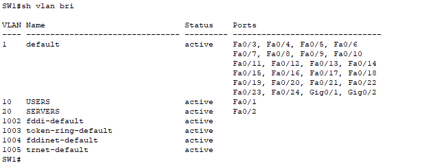
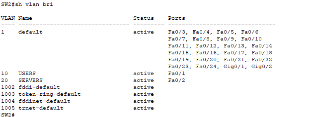
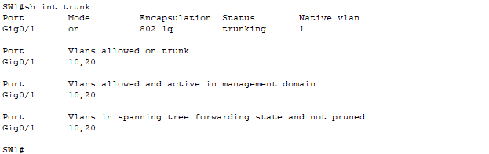
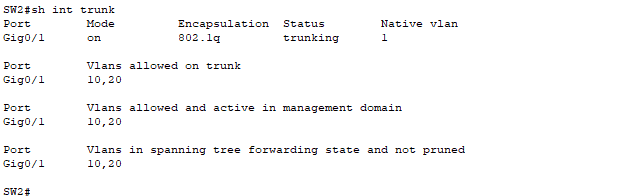
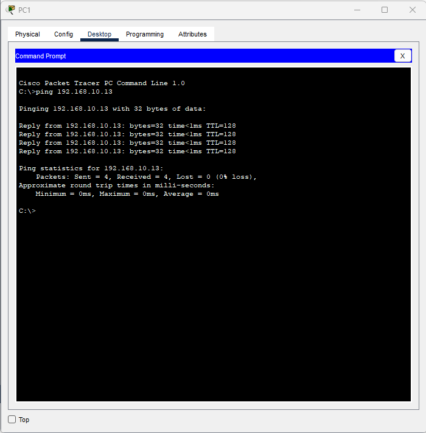
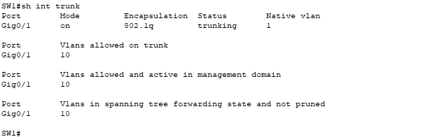
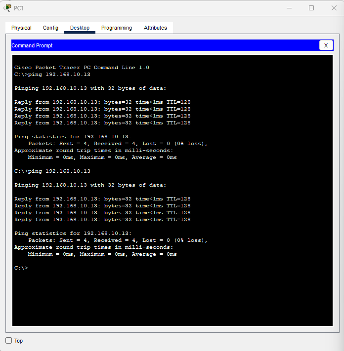
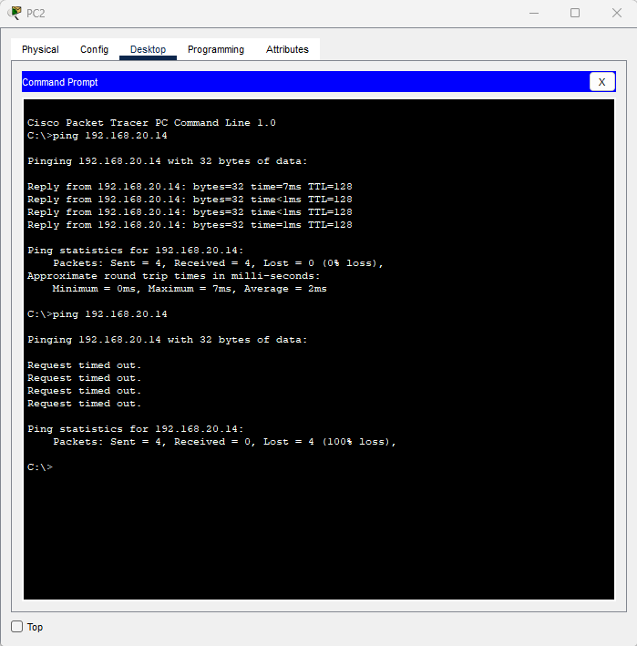
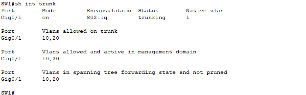
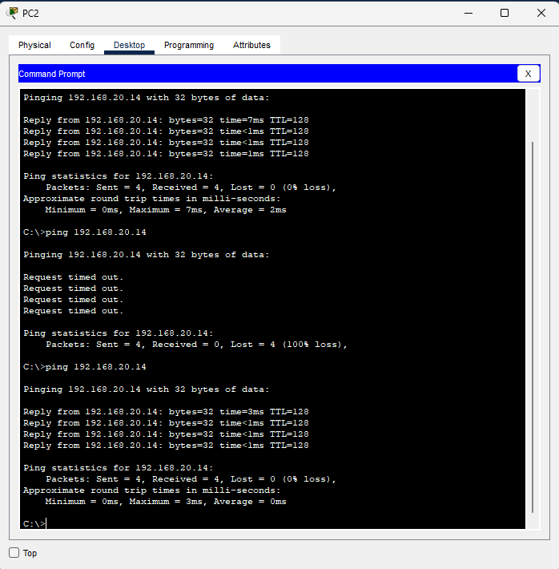

# VLAN Segmentation and Trunk Troubleshooting

Built two VLANs across two Cisco switches using an 802.1Q trunk in Packet Tracer. Removing VLAN 20 from SW1's trunk allowed list caused VLAN 20 connectivity to fail while VLAN 10 continued working. Adding VLAN 20 back restored connectivity.

## Environment and addressing

Two Cisco 2960 switches and four PCs. No router, inter-VLAN routing, default gateways, or DNS servers were configured.

| Host | Switch port | VLAN | IP address | Subnet mask |
| --- | --- | --- | --- | --- |
| PC1 | SW1 Fa0/1 | 10 — USERS | 192.168.10.11 | 255.255.255.0 |
| PC3 | SW2 Fa0/1 | 10 — USERS | 192.168.10.13 | 255.255.255.0 |
| PC2 | SW1 Fa0/2 | 20 — SERVERS | 192.168.20.12 | 255.255.255.0 |
| PC4 | SW2 Fa0/2 | 20 — SERVERS | 192.168.20.14 | 255.255.255.0 |

PC connections use copper straight-through cables. SW1 G0/1 connects to SW2 G0/1 using a copper crossover cable. The SERVERS name labels VLAN 20; its endpoints are PCs in this exercise.

## Objectives

- Create VLANs and assign access ports on both switches.
- Configure a trunk carrying VLANs 10 and 20.
- Interpret allowed, active, and spanning-tree forwarding VLAN lists.
- Establish successful same-VLAN communication across switches.
- Diagnose a missing allowed VLAN while the trunk remains operational.
- Restore the VLAN using the `add` keyword and verify recovery.

## 1. Configure VLANs and access ports

On each switch, set its hostname to SW1 or SW2, then apply:

```text
configure terminal
vlan 10
name USERS
exit
vlan 20
name SERVERS
exit
interface fastEthernet0/1
switchport mode access
switchport access vlan 10
exit
interface fastEthernet0/2
switchport mode access
switchport access vlan 20
end
show vlan brief
```

Both switches showed VLAN 10 active on Fa0/1 and VLAN 20 active on Fa0/2.





## 2. Configure and verify the trunk

On both switches:

```text
configure terminal
interface gigabitEthernet0/1
description TRUNK-BETWEEN-SW1-SW2
switchport mode trunk
switchport trunk allowed vlan 10,20
end
show interfaces trunk
```

After allowing spanning tree to converge, both switches showed:

| Field | Baseline value |
| --- | --- |
| Port | Gig0/1 |
| Mode | on |
| Encapsulation | 802.1q |
| Status | trunking |
| Native VLAN | 1 |
| VLANs allowed | 10,20 |
| VLANs allowed and active | 10,20 |
| VLANs forwarding and not pruned | 10,20 |

Initial output did not yet show both VLANs forwarding. Rechecking after a wait showed 10,20 on both switches; no configuration correction was needed for that initial transition.





## 3. Verify baseline connectivity

Static IP addresses were assigned using each PC's Desktop → IP Configuration. Default gateway and DNS fields were left blank.

From PC1:

```text
ping 192.168.10.13
```

From PC2:

```text
ping 192.168.20.14
```

Both tests returned four of four replies with 0% loss, confirming communication within each VLAN across the trunk.




## 4. Introduce an allowed-VLAN fault

On SW1 only:

```text
configure terminal
interface gigabitEthernet0/1
switchport trunk allowed vlan 10
end
show interfaces trunk
```

This command replaced SW1's allowed list with VLAN 10 only. VLAN 20 still existed in the VLAN database and its access-port assignments were not changed, but it was no longer permitted across SW1's trunk.

The trunk continued to show `trunking`, with only VLAN 10 in its allowed, active, and forwarding lists.



Repeating the same ping tests produced:

| Test | During fault |
| --- | --- |
| PC1 → PC3, VLAN 10 | 4/4 replies, 0% loss |
| PC2 → PC4, VLAN 20 | 0/4 replies, 100% loss |





The successful VLAN 10 test and operational trunk narrowed the problem to a VLAN-specific setting. Comparing the intended allowed list with SW1's output identified VLAN 20's omission.

## 5. Restore VLAN 20 and verify

On SW1 only:

```text
configure terminal
interface gigabitEthernet0/1
switchport trunk allowed vlan add 20
end
show interfaces trunk
```

The `add` keyword preserved VLAN 10 and added VLAN 20. Verification showed VLANs 10,20 allowed, active, and forwarding again.



From PC2:

```text
ping 192.168.20.14
```

PC2 reached PC4 with four of four replies and 0% loss.



Both switch configurations were saved:

```text
copy running-config startup-config
```

The Packet Tracer project was also saved.

## Results and lessons

| Stage | SW1 allowed VLANs | VLAN 10 ping | VLAN 20 ping |
| --- | --- | --- | --- |
| Baseline | 10,20 | 4/4 | 4/4 |
| Fault | 10 | 4/4 | 0/4 |
| Recovery | 10,20 | Not repeated after repair | 4/4 |

- An operational trunk does not prove that every required VLAN can cross it.
- Check VLAN existence, access-port assignments, trunk allowed lists, and spanning-tree forwarding state separately.
- `switchport trunk allowed vlan 10` replaces the allowed list; `switchport trunk allowed vlan add 20` adds to it.
- Test an unaffected VLAN alongside the failing VLAN to help establish the scope of a fault.

## Scope

This lab tested same-VLAN ICMP connectivity across a single trunk and a deliberate allowed-list omission on SW1. Inter-VLAN connectivity, firewall policy, native-VLAN mismatch, redundant-link failover, and VLAN-hopping resistance were not tested. Separate VLANs provide separate Layer 2 broadcast domains; this exercise does not demonstrate a complete security policy. No convergence time or uninterrupted traffic measurement was performed.

## Project file

[Download the Packet Tracer lab](vlan-trunk-troubleshooting.pkt)
